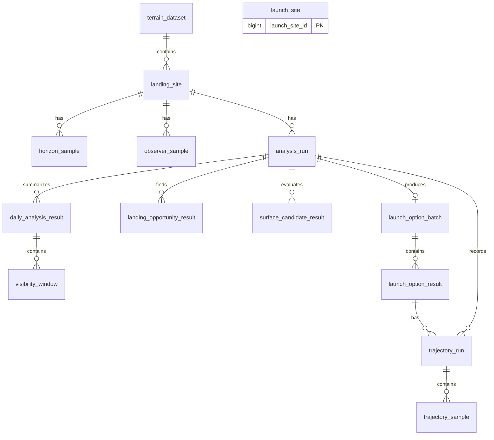

# AZAS Backend

[운영 Swagger UI](https://api.azas.n-e.kr/docs) · [LAMP 서비스](https://azas-app.vercel.app/)

LAMP(Lunar Access and Mission Planning)는 달 남극 후보지 27곳 중 한 곳과 임무 마감일을 선택하면 착륙 가능한 시간을 찾아주는 서비스입니다. 이 백엔드는 접지 가능 구간, 지구 발사장별 일정, 예비 달 전이 궤적과 착륙 후 하늘 데이터를 제공합니다.

## 구현 범위와 분석 기준

- **접지 가능 구간** — 2027년 1월 1일 UTC부터 사용자가 지정한 마감 시각까지 10분 간격으로 태양과 지구의 고도를 해당 방위각의 지형 지평선과 비교합니다. 기본 조건은 지표 위 1m에서 두 천체가 모두 지평선보다 높은 상태로 48시간 연속 활동할 수 있는 것입니다. `earliestTouchdownUtc`는 이 조건을 만족하는 첫 구간의 시작입니다.
- **발사와 전이** — 첫 접지 시각에서 역산해 지구 발사장별 발사, 달 전이 진입(TLI), 달 도착, 접지 시각을 UTC로 제공합니다. 발사 후보를 선택하면 JPL Horizons의 지구·달 위치를 이용해 TLI부터 달 도착까지의 예비 궤적을 계산합니다.
- **착륙 후 하늘** — 선택한 접지 후보의 활동 시간 동안 태양과 지구의 방위각·고도각과 지형 차폐 여부를 제공합니다. 후보지 상세의 미리보기와 착륙 후 응답은 같은 기준으로 2027~2028년의 UTC 일별 가시율을 평균합니다.

## 데이터 모델 (ERD)



`analysis_run`은 달 후보지 하나에 대한 분석 실행입니다. `launch_site`는 지구 발사장 기준표이며, 발사 후보를 저장할 때 해당 발사장의 코드와 좌표를 결과에 복사합니다. [전체 컬럼과 키 정의](docs/erd.dbml)

## 로컬 실행과 초기 데이터 적재

저장소 루트에서 Docker Compose 2.24 이상으로 Spring Boot(Java 21)와 PostgreSQL 17을 시작합니다.

```powershell
docker compose --env-file docker/postgres.env --file compose.local.yaml up --build --detach --wait --wait-timeout 180
```

기본 설정으로 API는 `127.0.0.1:8000`, DB는 `127.0.0.1:55432`에서 열립니다. 프론트엔드의 로컬 주소를 추가할 때는 `.env.example`을 참고해 `.env`의 `AZAS_CORS_ORIGINS`에 허용할 주소를 JSON 배열로 지정하세요. [로컬 Swagger UI](http://127.0.0.1:8000/docs) · [DB 연결 설정](docs/database.md)

Flyway가 빈 DB에 스키마를 생성하면 사용할 기능에 따라 데이터를 적재합니다.

| 기능 | 새 DB에 필요한 데이터 |
| --- | --- |
| 후보지 조회 | DataGrip에서 지형 데이터셋 → 후보지 → 지평선 표본 순으로 CSV 세 개를 가져온 뒤 `after-import.sql`을 실행합니다. 예상 결과는 데이터셋 1개, 후보지 27개, 지평선 표본 97,200개입니다. [CSV와 적재 순서](docs/terrain-data.md#새-db에-업로드) |
| 접지 시각·가시율 분석 | 별도 원본 `LLSN-Java21-ver2`의 `observer-2027-2029`에서 분석할 후보지의 CSV를 가져옵니다. 파일 이름의 후보지 코드를 `landing_site_id`와 매칭하고, UTC 시각과 태양·지구 관측각을 `observer_sample`에 넣습니다. |
| 발사 일정·궤적 | 같은 원본의 `experiments/launch_sites.csv`를 `launch_site`에 적재합니다. 원본 행 순서가 발사장 ID 1~13에 대응합니다. [컬럼 매핑](docs/database.md#스키마-변경) |

## API 사용 흐름

아래 경로의 공통 접두사는 `/api/v1`입니다. 한 번 접수한 `runId`로 접지 결과부터 궤적까지 조회합니다.

| 단계 | 요청 | 응답에서 사용할 값 |
| --- | --- | --- |
| 후보지 선택 | `GET /landing-sites` · `GET /landing-sites/{id}` | 목록의 `landingSiteId`가 `{id}`입니다. 상세의 `meanDailyVisibility`에서 태양·지구 평균 가시율을 읽습니다. |
| 분석 접수 | `POST /landing-sites/{id}/date-opportunities` | 본문에 `{"missionDeadlineUtc":"2027-01-31"}`처럼 마감일을 보냅니다. HTTP 202 응답의 `data.analysisRunId`가 `{runId}`입니다. |
| 접지 구간 확인 | `GET /analyses/{runId}` · `GET /analyses/{runId}/date-opportunities` | `executionStatus`가 `SUCCEEDED`이면 `windows`와 `earliestTouchdownUtc`를 확인합니다. 만족 구간이 없으면 첫 접지 시각은 `null`입니다. |
| 하늘·타임라인 조회 | `GET /analyses/{runId}/surface-candidates/{candidateId}/post-landing` · `GET /analyses/{runId}/daily-results` | 첫 접지에서 본 하늘은 접지 결과의 `candidates`에서 `proposedLandingUtc`가 첫 접지 시각인 후보의 `candidateId`로 조회합니다. 일별 결과는 `?date=YYYY-MM-DD`로 선택할 수 있습니다. |
| 발사장 선택 | `GET /analyses/{runId}/launch-options` | `launchSites`에서 발사장을 고르고 그 안의 `candidates`에서 `candidateId`와 네 단계의 UTC 일정을 읽습니다. 발사장에 따라 후보가 없을 수 있습니다. |
| 궤적 계산·재조회 | `POST /analyses/{runId}/launch-options/{candidateId}/trajectory` · `GET /analyses/{runId}/trajectories/{trajectoryId}` | 선택한 **발사 후보** ID로 계산한 뒤 `trajectoryRunId`를 저장합니다. 같은 궤적을 다시 열 때는 그 ID로 GET을 호출합니다. |

요청 옵션, 응답 필드, 실패 코드는 [분석 API 가이드](docs/analysis-api.md)에서 확인할 수 있습니다.

## 검증 방법과 알려진 한계

- **로컬 확인** — DB 연결이 정상이면 readiness가 `UP`을 반환합니다. 지형 적재 후 Swagger에서 `GET /api/v1/landing-sites`를 실행하면 후보지 27개를 확인할 수 있습니다. [Readiness](http://127.0.0.1:8000/actuator/health/readiness)
- **자동 테스트** — JDK 21과 Docker가 준비된 환경에서 `./gradlew check bootJar`를 실행합니다. Windows에서는 `.\gradlew.bat check bootJar`를 사용합니다. 통합 테스트는 Testcontainers로 별도의 PostgreSQL을 띄웁니다.
- **가시성 해석** — 접지 분석에 필요한 10분 격자의 관측값이 빠지면 `OBSERVER_DATA_INCOMPLETE`로 실행이 실패합니다. 가시율은 천체 중심이 지형 지평선 위에 있는 시간의 비율이며, 실제 발전량과 통신 품질은 별도 검증이 필요합니다.
- **궤적 해석** — 발사 시각은 가정한 주차 궤도의 기하 조건으로 구한 후보입니다. 전이 궤적은 지구 중심 2체 모델로 달 도착까지 계산하며, 달 궤도 진입과 표면 하강은 모델 범위 밖입니다.
